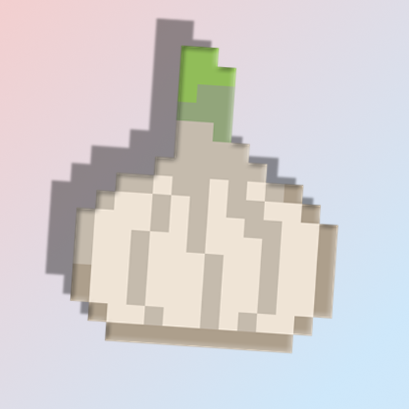

<html>

 

</html>

# Garlic Mod
This is mod for minecraft they added garlic and you can grow this 

Version minecraft 1.21.1 neoforge

- Items
  - Garlic
  - Garlic seed
  - Garlic husk
  - Golden garlic
- Blocks 
  - Garlic plant
- Crafts
  - You can craft 1 golden garlic out of 1 garlic and 8 gold nuggets.
